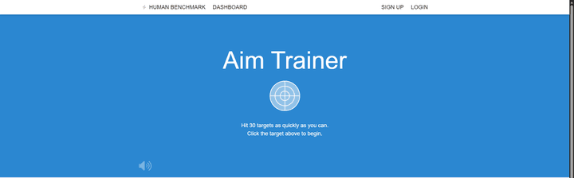

# Aim Trainer Bot

An educational computer vision project: a bot that plays the [Human Benchmark Aim Trainer](https://humanbenchmark.com/tests/aim) using a custom-trained YOLO model to find targets on screen.

<!-- TODO: replace with your demo GIF -->


## Pipeline

1. **Capture screenshots** of the aim trainer with `screen_cap.py` (uses `mss`).
2. **Label** the targets in [Label Studio](https://labelstud.io/) (single class: `target`), exporting in YOLO format.
3. **Split** the labeled data into train/val with `yolo_for_target/split_dataset.py`.
4. **Train** a YOLO model on the split dataset.
5. **Run live detection**: `aim_bot.py` grabs the screen with `mss` and runs the model on every frame.
6. **Click** the detected target with `pyautogui`.

## Result

About **100 ms per target on average**, running on CPU only.

## Setup

Requires Python 3.10+ and [VLC](https://www.videolan.org/vlc/) (only for the hit sound; `python-vlc` is a wrapper around it).

```bash
python -m venv venv
venv\Scripts\activate        # Windows
pip install -r requirements.txt
```

## Usage

### 1. Capture screenshots

```bash
python screen_cap.py
```

Opens the aim trainer and saves 60 screenshots (one every 0.5 s) to `Screen_cap/`. Start the test while it runs.

### 2. Label

Import the screenshots into Label Studio, draw a box around each target with the label `target`, and export as YOLO. Put the images in `yolo_for_target/images/` and the label `.txt` files in `yolo_for_target/labels/`.

### 3. Split into train/val

```bash
python yolo_for_target/split_dataset.py
```

Moves images and labels into `train/` and `val/` subfolders (80/20, fixed seed).

### 4. Train

```bash
cd yolo_for_target
yolo detect train data=data.yaml model=yolo26n.pt epochs=100 imgsz=640 batch=16
```

Copy the resulting `runs/detect/train*/weights/best.pt` next to `aim_bot.py`. A trained `best.pt` is already included in this repo.

### 5. Run the bot

Place a hit sound named `osu-hit-sound.mp3` next to `aim_bot.py` (not included; if it's missing the bot still runs, just silently). Then:

```bash
python aim_bot.py
```

It opens the aim trainer, waits 5 seconds, then detects and clicks targets until 31 hits. The bot captures your **primary monitor**, so keep the browser there with the test visible. Move the mouse to a screen corner to trigger PyAutoGUI's fail-safe and stop it.

## What I learned

I already knew how YOLO models work and how to train them, and I'd used pyautogui a bit before. This project was about wiring everything together into something that runs live, and that's where most of the learning happened.

- **Screen capture:** `mss.shot()` saves to disk, while `grab()` keeps pixels in memory, which is what a live loop needs. mss returns BGRA, so the alpha channel has to be dropped before passing frames to YOLO.
- **Dataset structure:** `images/` and `labels/` must mirror each other, `data.yaml` ties it together, and validation images must never appear in the training set, or the metrics look better than they really are.
- **CLI vs Python API:** running YOLO through `subprocess` can't hand back coordinates to your script. The Python API is needed for anything live.
- **Hardware:** I trained and ran everything on CPU, since my AMD GPU doesn't support CUDA. A nano model was still fast enough, at about 27 ms inference per frame.
- **pyautogui's hidden delay:** by default it waits 0.1 s after every call. Setting `PAUSE = 0` was the single biggest speedup.
- **Real-time timing:** after a click, the old target stays on screen for a frame or two, which caused double clicks. I had to balance speed against the browser's render lag.

## Fair play

This is a learning project. **Please don't submit bot scores to Human Benchmark leaderboards.**
